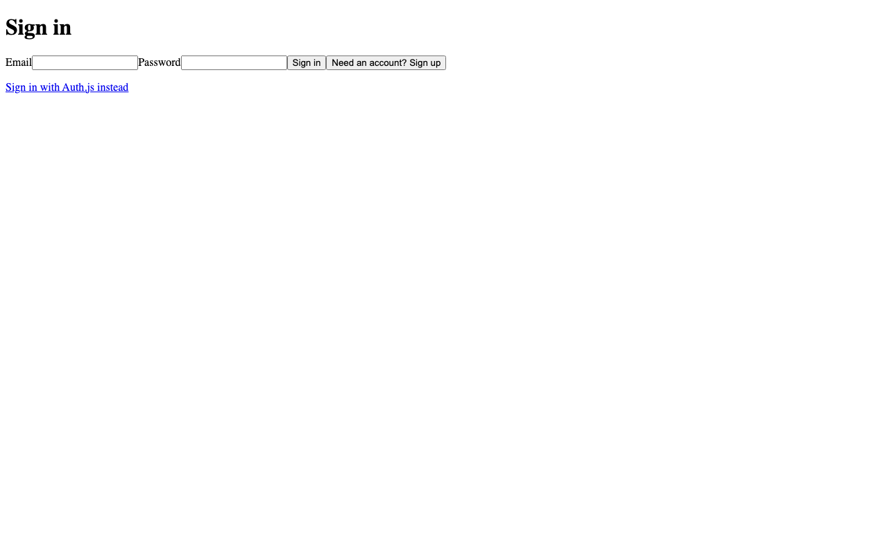
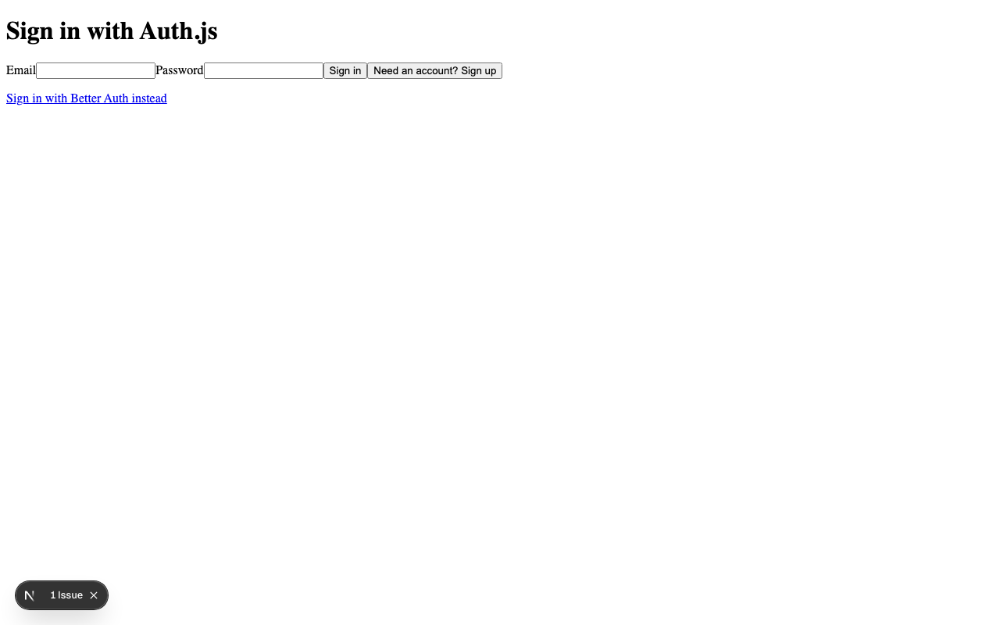
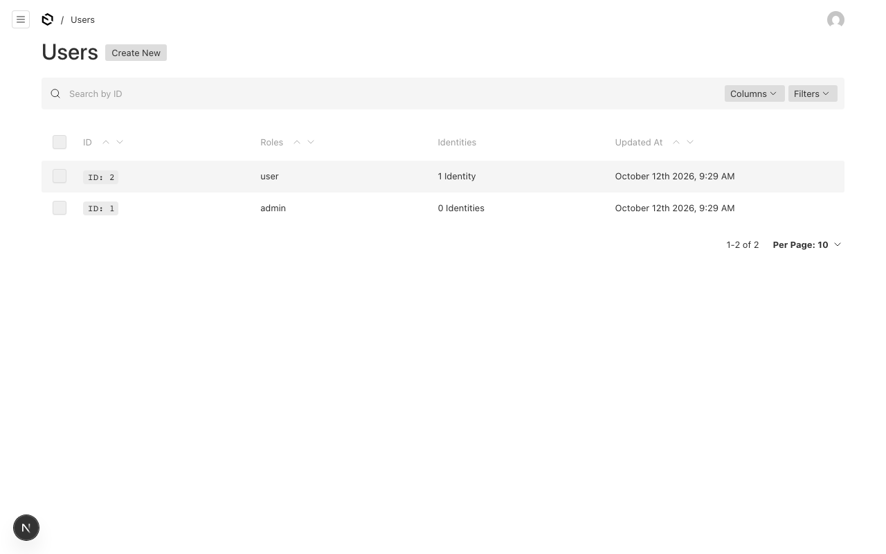

# Tour

A file-by-file walkthrough of `examples/basic` — the reference
integration every guide points back to, and the e2e target on all
three databases. Read this after [Getting started](getting-started.md)
to understand _why_ each piece exists.

Screenshots (regenerate with `bun run docs:media`):

## Packages (what you install)

| Package                                   | Role                                                                                                                 | Imports                                                       |
| ----------------------------------------- | -------------------------------------------------------------------------------------------------------------------- | ------------------------------------------------------------- |
| `@payload-auth-link/core`                 | Domain: ports, `Role`, errors, wire contract. Framework-free — lint-proven zero framework imports.                   | `neverthrow`, `zod`                                           |
| `@payload-auth-link/plugin`               | Payload citizen: users extension, strategy, session endpoints, admin UI.                                             | `core`, `neverthrow`, `payload` (+ `react` peer for `admin/`) |
| `@payload-auth-link/react`                | Provider-agnostic UI: context, buttons, menu, role gates.                                                            | `core`, `react`                                               |
| `@payload-auth-link/web`                  | Framework-free web: route handlers, verifier, authz, redirect safety. No framework imports.                          | `core`                                                        |
| `@payload-auth-link/next`                 | Next adapter: Edge middleware, client refresh, server provider. Re-exports `web`. Only package importing `next/*`.   | `core`, `react`, `web`, `next`                                |
| `@payload-auth-link/tanstack-start`       | Start adapter: route handlers, request middleware, loaders, refresh. Re-exports `web`. Only package importing Start. | `core`, `react`, `web`, Start                                 |
| `@payload-auth-link/provider-better-auth` | Better Auth engine, Payload database adapter, port, collections.                                                     | `core`, `neverthrow`, `better-auth`, `payload`                |
| `@payload-auth-link/provider-authjs`      | Auth.js engine, Payload database adapter, credentials service, port, collections.                                    | `core`, `neverthrow`, `@auth/core`, `payload`                 |

Dependency rules (enforced by `no-restricted-imports`): `core`
imports nothing internal; UI packages never import Payload; React
never appears in the plugin outside `admin/`.

## The example, file by file

### `lib/auth.ts` — Better Auth engine

Creates the engine and re-exports the three things the rest of the
app needs: `auth` (the Better Auth instance for routes),
`betterAuthProvider` (for the plugin registry),
`betterAuthCollections` (for the Payload config). `loadPayload`
breaks the config ↔ engine import cycle with a cached dynamic
import.

### `lib/authjs.ts` — Auth.js engine (coexistence proof)

The same three exports for Auth.js: engine (JWT sessions, Credentials
provider wired to the credentials service), `handleAuthJsRequest`
for the catch-all route, `registerAuthJsUser` for the signup route.
Both providers live in one app to prove the registry design — most
sites pick one.

### `lib/auth-cookie-names.ts` — Edge-safe names

Computes both providers' session cookie names through the
dependency-free `/cookies` subpaths. The middleware imports this —
never the engines, which would drag `payload` and database code into
the Edge bundle and fail the build.

### `lib/session.ts` — Server verifier

`createSessionVerifier({ baseUrl })`, anchored to the configured
origin. The request-host fallback exists for local development only —
in production the origin must be explicit, because host headers are
client-spoofable and the session cookie is forwarded to that origin.
`EXAMPLE_BASE_URL` matches the running port in every mode, so the
example needs no per-mode configuration.

### `payload.config.ts` — Plugin wiring

SQLite file DB (switchable to Postgres/Mongo via `PAYLOAD_DB` for
parity runs), `users` + `pages` collections, both providers'
collections, the `authLink` plugin call, and an `onInit` seed for the
local admin. Provider users are never seeded — they provision
just-in-time at first session verification.

### `app/api/auth/[...all]/route.ts` — Better Auth routes

Mounts `auth.handler` with the uniform error envelope. All Better
Auth paths (`/sign-up/email`, `/sign-in/email`, `/sign-out`, …)
serve from here.

### `app/api/authjs/[...authjs]/route.ts` — Auth.js routes

Mounts the Auth.js engine's `handleRequest` at the engine's default
`/api/authjs` basePath — chosen to coexist with Better Auth's
`/api/auth`.

### `app/api/authjs-signup/route.ts` — Builder signup

Auth.js credentials store nothing themselves, so signup is an
explicit service call. This route wraps `registerAuthJsUser`,
answering new and already-registered emails identically (no
enumeration oracle; duplicates are an out-of-band notice) and
weak-password/bad-email → 400.
It stamps `emailVerified` immediately — **local example only** (no
email delivery); production builders verify out-of-band first.

### `middleware.ts` — Optimistic Edge check

Presence of any session cookie lets the request through; absence
redirects to `/sign-in?redirect=…`. UX only — route protection here
bounces obvious anonymous traffic early; authorization always happens
on Node (verifier, strategy) against live state.

### `app/(frontend)/layout.tsx` — Hydration

`AuthLinkServerProvider` validates the session on Node per request
and hydrates the client provider, so first paint already knows the
user — no loading flash, no client fetch waterfall.

### `app/(frontend)/sign-in/` — Better Auth form

Sign-in/sign-up modes POSTing JSON to `/api/auth/*`, then
`useAuthLinkRefresh()` + `router.push(safeRedirectPath(redirect))` —
the redirect param is attacker-controlled input, so it is narrowed to
an in-app path before navigation (open-redirect e2e asserts this).
Errors render in `role="alert"` (the e2e wrong-password spec asserts
this).

### `app/(frontend)/sign-in-authjs/` — Auth.js form

Same UX over a different protocol: signup via the builder route,
then CSRF token + form POST to `/api/authjs/callback/credentials`,
follow the 302, and read success/failure from the final URL (Auth.js
always redirects — see the [Auth.js guide](guide-authjs.md)).

### `app/(frontend)/account/page.tsx` — Session consumer

`useAuthLink()` for user/roles plus `UserMenu` (email + honest
sign-out: revokes server-side, navigates home only on success).
`data-testid` hooks serve the e2e specs.

### `app/(frontend)/admin-only/page.tsx` — Server-enforced roles

`requireRoles` on Node before anything renders: anonymous visitors
bounce to sign-in, non-admins hit `notFound()`, and only admins ever
receive the content (e2e asserts the secret is absent from denied
responses). `RequireRoles` is UI-hiding only — it must never gate
content, because server-rendered children ship in the RSC payload
regardless.

## `examples/tanstack-start` — Same app on Start

The TanStack example mirrors `basic` file for file on Payload v4;
only the framework surface differs (see the [TanStack Start
guide](guide-tanstack-start.md)):

- `src/lib/auth.ts` — engine with `tanstackStartCookies()` in the
  builder's own `options.plugins` (never `nextCookies()` here).
- `src/app/api.auth.$.ts`, `api.authjs.$.ts` — splat routes via
  `createServerRouteHandlers`.
- `src/start.ts` — `createAuthRequestMiddleware` (+ reinstalled
  CSRF middleware); `/_serverFn/` stays public or RPC breaks.
- `src/lib/session.ts` — shared verifier plus `getSessionUser` /
  `requireAdminUser` server functions.
- `src/app/_frontend.tsx` — `createSessionLoader` hydration into
  `AuthLinkProvider initialUser`.
- `src/app/_frontend/admin-only.tsx` — `beforeLoad` awaits the
  server-function gate; same `admin-denied` marker as Next's
  `not-found.tsx` so one e2e suite covers both.

## Test layout

- `packages/*/src/__tests__/` — unit + SQLite-memory integration
  next to the code (490 tests).
- `e2e/` — one Playwright suite against both examples: auth
  flows, session lifecycle, admin inspection, a11y, smoke (24
  specs × 3 databases × 2 frameworks, with the SQLite suites run
  in Chromium, Firefox, and WebKit; `helpers.ts` holds the shared hydration and
  Payload-version locators).
- `e2e/run-{,tanstack-}mongo.mjs`,
  `playwright.{,tanstack-}{postgres,mongo}.config.ts` — parity
  harness: per-run databases, zero shared state.
